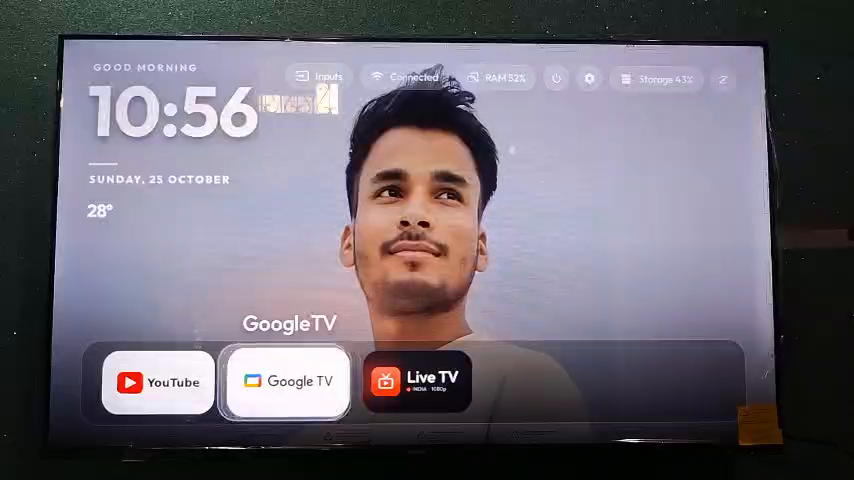
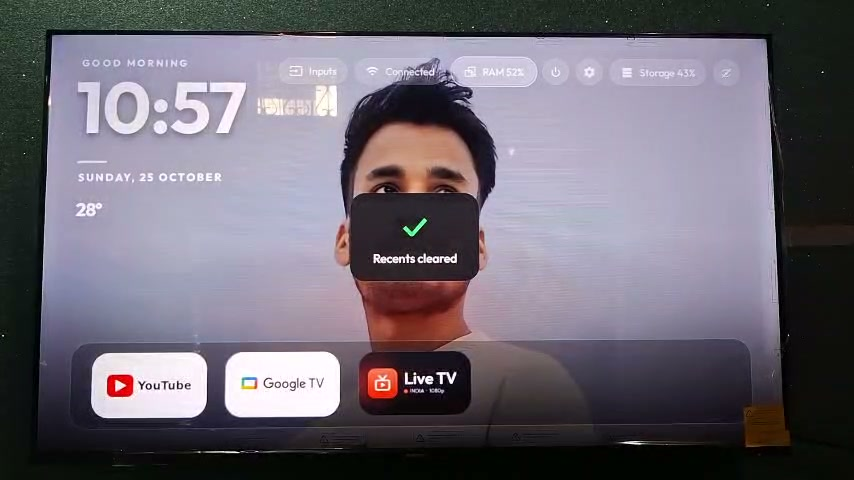
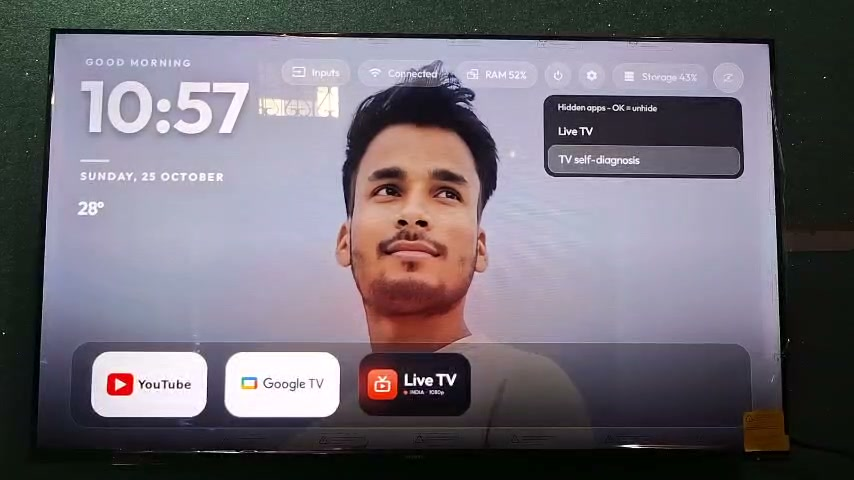
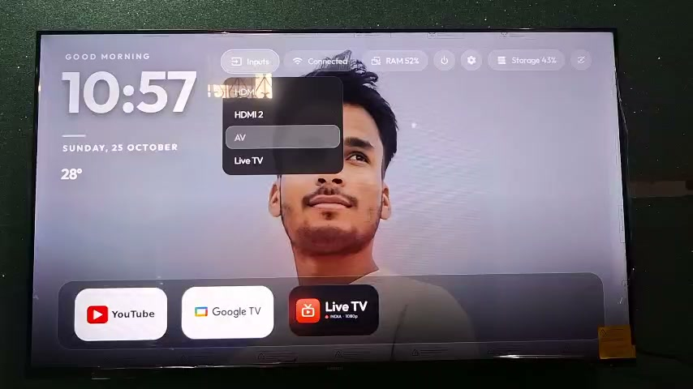
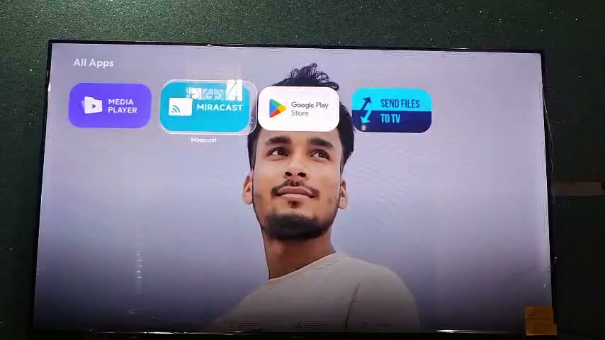

# 📺 AndroidTV Pro Launcher

> A fast, clean and beautiful home screen for your Android TV — with the **Jarvis AI voice assistant** built in.


## 🎬 Demo

▶️ **[Watch the full demo video (2 min)](demo/launcher-demo.mp4)** — the complete real TV demo, start to finish.

<video src="demo/launcher-demo.mp4" poster="screenshots/01-home.png" width="100%" controls></video>

*Demo video recorded on the previous build — the latest version additionally removes the on-screen temperature and the Storage pill, for an even cleaner top bar.*

## ✨ Features

- **Clean home screen** — greeting, large clock, date and your own photo wallpaper.
- **Smart top pills** — Inputs, Wi-Fi, RAM, Power, Settings, Hidden apps and Jarvis mic, all reachable from the remote.
- **Jarvis AI voice assistant** — tap the mic pill and just ask.
  - Local commands need no key: open apps, volume, time & date, Settings.
  - General questions use **Groq (free, no card, default)**, with Gemini and OpenRouter as options.
  - Long-press the mic pill to switch provider or change the key — keys stay on your TV only, never in the app.
- **RAM cleaner** — one tap on the RAM pill clears background apps (*"Recents cleared"*).
- **Hidden apps** — hide apps you don't use, unhide anytime with OK.
- **Inputs menu** — switch HDMI, AV and Live TV quickly.
- **Dock + app grid** — favourite apps on the dock, everything else in All Apps.

## 📸 Screenshots

| Home | RAM cleaner | Hidden apps |
|------|-------------|-------------|
|  |  |  |

| Inputs menu | All Apps |
|-------------|----------|
|  |  |

## ⬇️ Install

1. Download **TV_Launcher.apk** from the latest [Release](../../releases).
2. Send it to your TV with **Send Files to TV** (or a USB drive).
3. Open it on the TV and install, then press Home and choose **AndroidTV Pro Launcher** as your default home app.

## 🛠 Build from source

```bash
./gradlew assembleDebug
```

Requires Android SDK and JDK 17. Note: the debug signing config in `app/build.gradle` points to the author's local keystore — replace it with your own debug keystore (or remove the `signingConfigs` block) to build your own copy.

## 📱 Tested on

Xiaomi Mi TV · Android 9.0+ (API 28+)

## 📦 What's inside

- `app/src/` — launcher source (package `com.kulwant.atvhome`)
- `screenshots/` — screenshots taken from the real TV demo
- `demo/` — full demo video

---

Made for Android TV. ❤️
